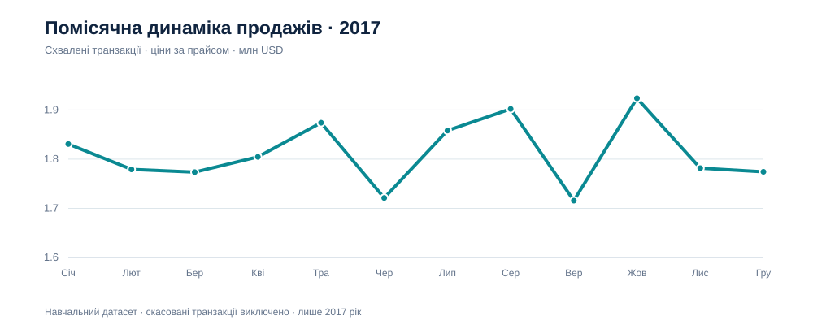

# Аналіз продажів велосипедного магазину

**Google Sheets · аналіз продажів · RFM**

Я двічі проходив практику з Google Таблиць за курсом Нікіти Тимошенка. Згодом повернувся до цього набору даних, щоб переробити дашборд: перевірити цифри, додати аналіз клієнтів і залишити тільки ті графіки, які можу пояснити.

[**Відкрити дашборд у Google Sheets**](https://docs.google.com/spreadsheets/d/14WX4AR71RnEAP1NhGv95m2r_TVtFwZBLpslukdR-1kg/edit)

## Що аналізував

У наборі було 20 000 транзакцій велосипедного магазину за 2017 рік. Після очищення залишилося 19 803 записи. Ще 178 замовлень мали статус `Cancelled`, тому в основні підсумки потрапили **19 625 схвалених транзакцій**.

| Показник | Результат |
|---|---:|
| Продажі за цінами з датасету | $21 739 495,29 |
| Різниця між ціною та стандартною собівартістю | $10 831 504,03 |
| Розрахункова маржа | 49,82% |
| Середня сума транзакції | $1 107,74 |
| Клієнтів із коректними ID | 3 482 |

Це суми за `list_price` і `standard_cost`, а не підтверджена виручка чи чистий прибуток компанії.

## Що помітив

- **Solex** має найбільшу суму продажів, але **WeareA2B** — найбільший розрахунковий прибуток.
- Найвищі продажі в межах 2017 року були **в жовтні**. Одного року замало, щоб говорити про сезонність.
- Онлайн- і офлайн-замовлень майже порівну: **9 642** та **9 631**. Для ще **352** замовлень канал невідомий.
- Під час перевірки знайшов **43 транзакції** з технічними ID виду `unkown...`. Їхні суми залишив у продажах, але самі заглушки виключив з підрахунку покупців.

Окремо зробив **RFM-сегментацію** за 3 482 коректними ID. Вона дала 897 активних цінних клієнтів, 562 цінних із нижчою нещодавньою активністю, 705 активних із рідкими покупками та 1 318 інших.

## Що є в Google Sheets

**Дашборд** із п'ятьма графіками та фільтром за брендом; **Звіт** із висновками; **Розрахунки** для звірки KPI; **Зведені дані** для графіків; **Методологія** з правилами розрахунків.

Публічний файл містить лише підсумкові таблиці. У ньому немає клієнтських імен, адрес, дат народження або рядків окремих транзакцій. Коли перемикаєш бренд, KPI, графік за місяцями, канали та категорії перераховуються зі зведених даних. RFM і порівняння всіх брендів залишаються загальними.

У папці [`data`](data/) є CSV із перевіреними агрегатами. Детальні правила — у [`METHODOLOGY.md`](METHODOLOGY.md).

## Що залишив за межами звіту

Не став публікувати регіональний графік: у робочому файлі знайшлися розбіжності під час повторного об'єднання адрес. Так само не робив прогноз відтоку — доступний лише один рік транзакцій, і цього недостатньо для такого висновку.

## Джерела

- [Курс Нікіти Тимошенка](https://youtu.be/gYjQRW6N6Ws) і [навчальні матеріали](https://github.com/Youtube-NikitaTymoshenko/googleSheets-course).
- Для структури аналізу переглядав приклади **KPMG Data Analytics Virtual Program**. Цифри з прикладів не переносив: підсумки та сегментацію перерахував на своїй очищеній версії.

Це навчальна робота для портфоліо, не комерційний проєкт.
